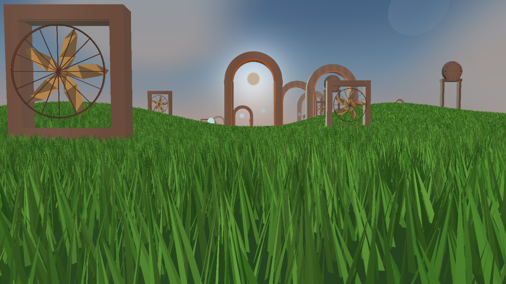
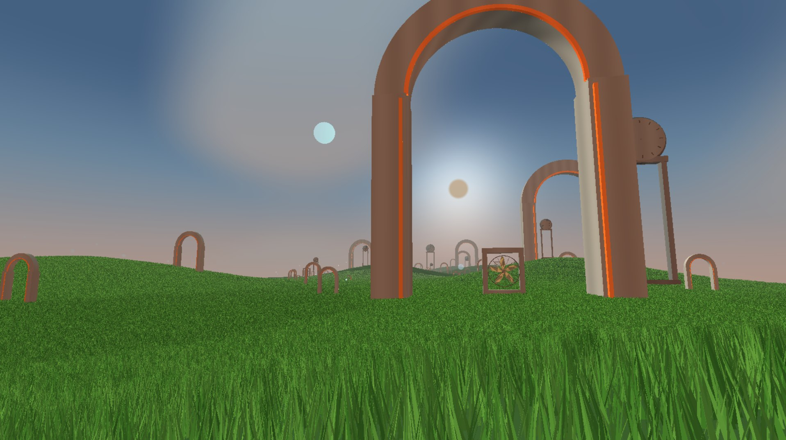

# Liminal Meadow DirextX

Лиминальная лужайка





# Запустить проект

.\LiminalDirectx\build\Release\VulkanMeadow.exe
Открой папку LiminalDirectx -> build -> Release и дважды щёлкни LiminalMeadow.exe

# Liminal Meadow

A native Direct3D 11 meadow for Windows: rolling procedural hills, 6.2 million
terrain-conforming dense grass clumps, oversized distant arches, clock towers,
floating bubbles, framed industrial fans, and a hazy world-space sunset sky.
The soundtrack in `music/music.mp3` loops in the background.

## Build and run

Open the folder in Visual Studio with the **Desktop development with C++**
workload, or build it with CMake:

```powershell
cmake -S . -B build
cmake --build build --config Release
.\build\Release\LiminalMeadow.exe
```

CMake copies the soundtrack beside the executable into `music/music.mp3`.

## Controls

- **W / A / S / D** — walk
- **Space** — jump
- **F** — toggle fullscreen
- **Mouse** — look around (the cursor is captured while the window is active)
- **R** — reset the view
- **Shift** — run
- **Esc** — exit
